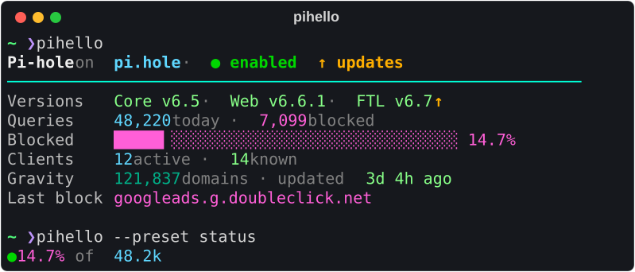
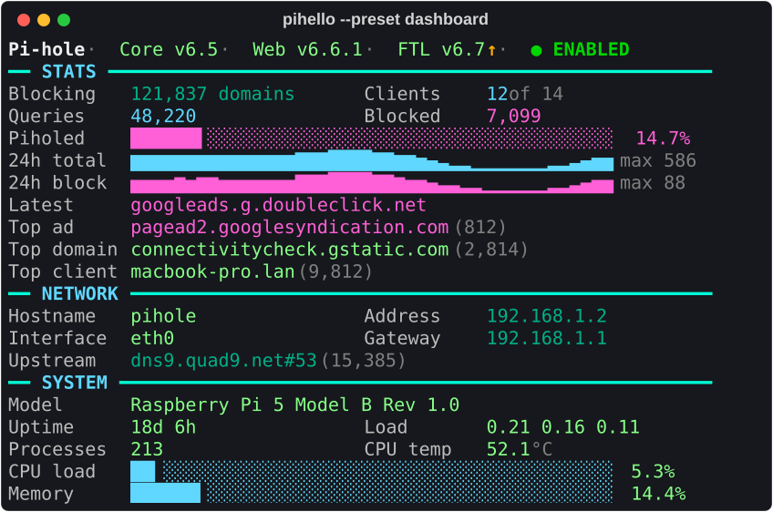
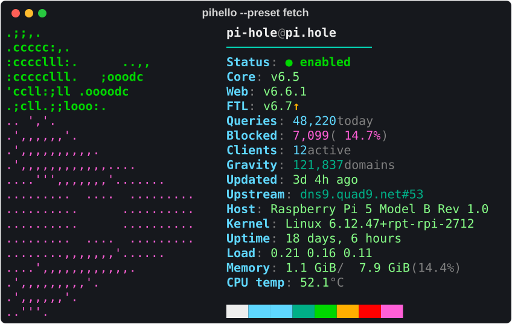
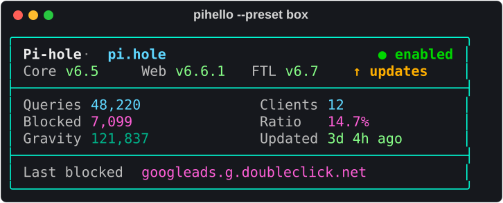
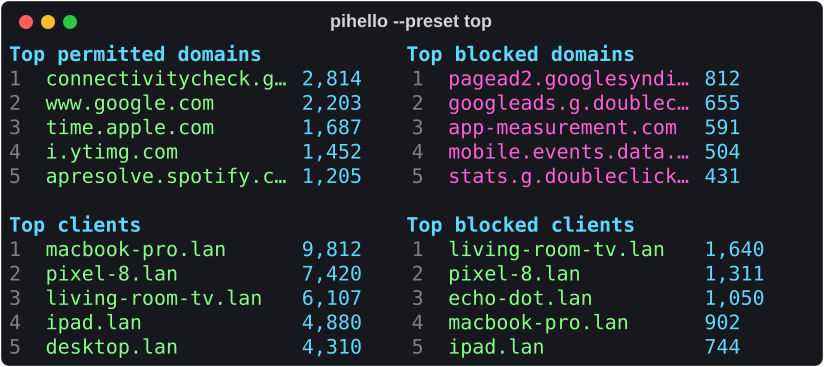

<div align="center">



# pihello

**Your Pi-hole at a glance, every time you open a terminal.**

[](https://pypi.org/project/pihello/)
[](https://pypi.org/project/pihello/)
[](docs/compatibility.md)
[](https://github.com/pavelgar/pihello/actions/workflows/ci.yml)
[](LICENSE)

[Install](#install) · [Quick start](#quick-start) · [Presets](docs/presets.md) · [Themes](docs/themes.md) · [Templates](docs/templates.md) · [Docs](docs/README.md)

</div>

pihello prints a short, colorful summary of your [Pi-hole](https://pi-hole.net):
whether ad blocking is on, how many queries were blocked today, versions and pending updates, and whatever else you want to see.
Put it in your shell's startup file, a MOTD or a tmux status bar, or run it as a live dashboard.
It's a pure-Python package of about 160 KB (1.2 MB installed) with no dependencies (only `tomli` on Python 3.10), made for Pi-hole v6.

| ⚡ **About 0.1 s per greeting** | 🎨 **15 presets × 11 themes** | 🧩 **Your own templates** |
| :-- | :-- | :-- |
| The default preset needs 6 API requests: a login, 4 fetches in parallel for just what it shows, and a logout. 0.05 s from the optional cache. `-q` keeps new shells clean when the Pi-hole is offline. | From a one-line tmux segment to a full dashboard. Every preset works with every theme. | Styles, conditional colors, filters, bars and sparklines, and [245 variables](docs/variables.md). |
| 🪄 **Guided setup** | 🔐 **Careful with secrets** | ✅ **Every Pi-hole v6 release** |
| `pihello init` takes you through five steps (address, password, preset, theme, save), tests the connection and prints the line for your shell. | Keep the password in a private file, a password manager or an environment variable. It's never printed. | [Tested](docs/compatibility.md) against 11 Pi-hole releases, v6.0 to v6.8, and `pihello doctor` explains what's wrong when something is. |

<sub>Timings: median of 15 runs of the installed package, Python 3.14 on a Ryzen 5 7500F,
against a Pi-hole 2026.10.0 container on the same machine. About 35 ms of that is Pi-hole
checking the password at login, which takes longer on a Raspberry Pi.</sub>

## Install

```sh
pipx install pihello        # or: uv tool install pihello
```

You need Python 3.10 or newer and Pi-hole **v6.0** or newer.
`pip install --user pihello` works too, except where the system pip refuses it (Debian, Ubuntu and Raspberry Pi OS).
For Pi-hole v5, use `pihello==0.3.0`.

## Quick start

1. **Create an app password** in the Pi-hole web interface: *Settings → Web interface / API → Configure app password*.
   App passwords also work with two-factor authentication; your normal password works too if 2FA is off.
2. **Run `pihello init`**: five steps for the address, password, preset, theme and saving.
   It tests the connection, writes the config and offers to add the greeting to your shell.
3. **Open a new terminal.** There's your Pi-hole.

No Pi-hole at hand?
`pihello --demo` shows everything with built-in sample data.

## A few of the looks

<table>
  <tr>
    <td width="50%"></td>
    <td width="50%"></td>
  </tr>
  <tr>
    <td><code>--preset dashboard</code>: PADD-style, with bars and 24 h sparklines</td>
    <td><code>--preset fetch</code>: neofetch-style, with the Pi-hole logo</td>
  </tr>
  <tr>
    <td></td>
    <td></td>
  </tr>
  <tr>
    <td><code>--preset box</code>: a framed MOTD</td>
    <td><code>--preset top</code>: top domains, blocked domains and clients</td>
  </tr>
</table>

There's also `default`, `compact`, `minimal`, `status` for status bars, `plain` for logs, `classic` for the exact pihello 1.x greeting, and more.
Pick the colors with `--theme`: `nord`, `dracula`, `gruvbox`, `catppuccin`, `solarized`, `tokyonight`, `monokai`, `pihole`, `classic16` or `mono`.

**→ See them all in the [preset gallery](docs/presets.md) and the [theme gallery](docs/themes.md),**
or in your own terminal with `pihello presets` and `pihello themes`.

## Shell greeting

`pihello init` prints the snippet for your shell and can add it for you.
Use `-q`, so an unreachable Pi-hole never puts error messages into a new shell.

<details>
<summary><b>bash</b> · <code>~/.bashrc</code></summary>

```bash
# Pi-hole greeting (pihello)
if [[ $- == *i* ]] && command -v pihello >/dev/null 2>&1; then
    pihello -q
fi
```

</details>

<details>
<summary><b>zsh</b> · <code>~/.zshrc</code></summary>

```zsh
# Pi-hole greeting (pihello)
if [[ -o interactive ]] && (( $+commands[pihello] )); then
    pihello -q
fi
```

</details>

<details>
<summary><b>fish</b> · <code>~/.config/fish/conf.d/pihello.fish</code></summary>

```fish
# Pi-hole greeting (pihello): replaces fish's default greeting
function fish_greeting
    type -q pihello; and pihello -q
end
```

If you already have a `fish_greeting` function, add the `type -q …` line to it instead.

</details>

<details>
<summary><b>PowerShell</b> · <code>$PROFILE</code></summary>

```powershell
# Pi-hole greeting (pihello)
if (Get-Command pihello -ErrorAction SilentlyContinue) { pihello -q }
```

Open the profile with `notepad $PROFILE`; create it first with `New-Item -Force $PROFILE` if it doesn't exist.

</details>

<details>
<summary><b>MOTD</b> for every login · <code>/etc/profile.d/pihello.sh</code></summary>

```sh
# /etc/profile.d/pihello.sh
case $- in
    *i*) command -v pihello >/dev/null 2>&1 && pihello -q ;;
esac
```

</details>

<details>
<summary><b>tmux</b> and status bars · <code>~/.tmux.conf</code></summary>

The `status` preset is a short segment (`● 14.7% of 48.2k`).
Bars do their own coloring, so turn colors off:

```tmux
# ~/.tmux.conf
set -g status-interval 30
set -g status-right '#(pihello -q --preset status --color never --cache 30) '
```

</details>

[Integrations](docs/integrations.md) has more: starship, waybar, polybar, Debian's `update-motd.d`, scripts and cron.

## Customising

Templates are plain text with `[style tags]` and `{expressions}`.
Start from a copy of a preset:

```sh
pihello presets default --source -o ~/.config/pihello/greeting.txt
```

Or write one from scratch:

```text
[@title]Pi-hole {version.core.local.version}[@muted] · [{blocking|map(enabled=@good, _=@bad)}]● {blocking}
[@label]Blocked [@highlight]{queries.blocked|number}[@muted] of {queries.total|number} ({queries.percent_blocked|percent})
[@label]Top ad  [@highlight]{top_blocked.0.domain|default("none")}
[@label]24h     [@accent]{history|pluck(total)|spark(30)}
```


Try it with `pihello --demo -f ~/.config/pihello/greeting.txt`,
then replace the `preset` line in the config file with `template = "~/.config/pihello/greeting.txt"`.
The [template guide](docs/templates.md) covers the language,
and the references list every [filter](docs/filters.md) and every [variable](docs/variables.md) you can show.

## Commands

| Command | Description |
| :-- | :-- |
| `pihello` | Print the greeting (same as `pihello show`) |
| `pihello init` | Interactive setup: address, password, preset, theme, shell snippet |
| `pihello doctor` | Check config, network, HTTPS, login and API step by step |
| `pihello presets [NAME]` | Preview the presets; `--source -o FILE` saves one to edit |
| `pihello themes [NAME]` | Preview the themes |
| `pihello vars [PATTERN]` | List the template variables with their values; `--json` for scripts |
| `pihello colors` | List the color names for templates |
| `pihello completion SHELL` | Tab completion for bash, zsh or fish |
| `pihello --watch [SECONDS]` | Live dashboard, refreshed every 5 s |
| `pihello --cache SECONDS` | Reuse data fetched less than SECONDS ago |
| `pihello --demo` | Use built-in demo data instead of a Pi-hole |

Every command has `--help`, and [Commands](docs/commands.md) has examples and every option.

## Configuration

`pihello init` writes `~/.config/pihello/config.toml` (`%APPDATA%\pihello\config.toml` on Windows):

```toml
# ~/.config/pihello/config.toml
url = "https://pi.hole"
password_file = "~/.config/pihello/password"
verify_tls = "tls_ca.crt"
preset = "default"
theme = "nord"
cache_ttl = 30

[profiles.backup]          # pihello -P backup
url = "http://192.168.1.3"
password_command = "pass show pihole-backup"
```

Command-line options and `PIHELLO_*` environment variables override the file.
[Configuration](docs/configuration.md) describes every setting, the password options, profiles, style overrides, HTTPS certificates and caching.

## Troubleshooting

Run **`pihello doctor`** first.
It checks every step from the config file to the API session and says what to do about each problem.

<details>
<summary>Nothing appears in new shells</summary>

That's `-q` hiding an error.
Run `pihello` without `-q` to see it.

</details>

<details>
<summary>New shells are slow when the Pi-hole is offline</summary>

Lower the network timeout: `timeout = 1` in the config (the default is 3 seconds).

</details>

<details>
<summary><code>could not resolve host 'pi.hole'</code></summary>

`pi.hole` only resolves on machines that use the Pi-hole as their DNS server.
Use its IP address or another host name.

</details>

<details>
<summary><code>TLS certificate verification failed</code></summary>

Pi-hole's HTTPS certificate is self-signed.
Copy `/etc/pihole/tls_ca.crt` from the Pi-hole and use `--ca-cert tls_ca.crt` (or `verify_tls = "tls_ca.crt"`).
The certificate is issued for `pi.hole`, so connect with that name.
`-k` / `--insecure` skips the check.

</details>

<details>
<summary><code>two-factor authentication enabled</code></summary>

pihello can't enter TOTP codes.
Create an app password (see [Quick start](#quick-start)) and use that.

</details>

<details>
<summary><code>Pi-hole has no free API sessions</code></summary>

Pi-hole allows 16 API sessions at a time by default (`webserver.api.max_sessions`).
pihello always logs out, but other tools may not.
Old sessions expire after 30 minutes, or delete them under *Settings → Web interface / API*.

</details>

<details>
<summary><code>Pi-hole is rate-limiting login attempts</code></summary>

Pi-hole accepts at most 3 logins per second, so opening many terminals at once (e.g. tmux restoring panes) can trip it.
pihello retries up to twice, after a random 0.35–1.1 s pause and within the timeout;
set `cache_ttl = 30` so new shells within 30 seconds reuse the last result instead of logging in.

</details>

<details>
<summary><code>?</code> instead of a value</summary>

The value isn't available on your Pi-hole, or the variable name has a typo.
`pihello --strict` names the culprit, and `pihello vars` shows what's there.

</details>

<details>
<summary><code>?</code> in place of symbols like ●, ↑ or box lines</summary>

The terminal's locale isn't UTF-8 (e.g. `LANG=en_GB.ISO-8859-1`, common on older Raspberry Pi OS installs; check with `locale`),
so pihello prints `?` for the characters it can't show.
Switch to a UTF-8 locale (`sudo raspi-config` → *Localisation Options* → *Locale*, or `sudo dpkg-reconfigure locales`, then pick e.g. `en_GB.UTF-8`),
or use `--preset plain`, which is ASCII-only.

</details>

<details>
<summary>Wrong or no colors</summary>

Set `--color 256` or `--color truecolor`, check that `NO_COLOR` isn't set, and use `--color always` when piping.

</details>

[Troubleshooting](docs/troubleshooting.md) has the details and more error messages.
Still stuck? [Open an issue](https://github.com/pavelgar/pihello/issues) with the output of `pihello doctor` (it never contains your password).

## Upgrading from 1.x

Your `pihello ADDR PASSWORD -f FILE …` command and template files keep working, and the `classic` preset is the exact 1.x look.
Running `pihello init` once moves the password out of your shell history.
[Upgrading from 1.x](docs/upgrading.md) lists every change.

## Documentation

| Page | Description |
| :-- | :-- |
| [Commands](docs/commands.md) | Every command and option, with examples |
| [Configuration](docs/configuration.md) | The config file, passwords, profiles, HTTPS, caching, environment variables |
| [Integrations](docs/integrations.md) | Shells, MOTD, tmux, starship, status bars, scripts |
| [Templates](docs/templates.md) | How to write your own greeting |
| [Filters](docs/filters.md) · [Variables](docs/variables.md) | Every filter and every value a template can use |
| [Presets](docs/presets.md) · [Themes](docs/themes.md) | The galleries |
| [Troubleshooting](docs/troubleshooting.md) | Problems, error messages and fixes |
| [Upgrading from 1.x](docs/upgrading.md) | What changed and what still works |
| [Pi-hole compatibility](docs/compatibility.md) | Tested versions and API details |
| [Architecture](docs/architecture.md) | How the code fits together |
| [Changelog](CHANGELOG.md) | Release notes |

## Development

Contributions are welcome.
[Contributing](CONTRIBUTING.md) explains the setup (`uv sync`), the checks and the tests.

---

<div align="center">
<sub>MIT licensed · pihello is an independent project, not affiliated with Pi-hole LLC.</sub>
</div>
