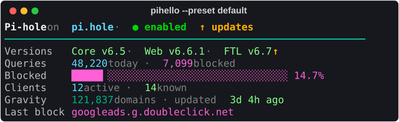
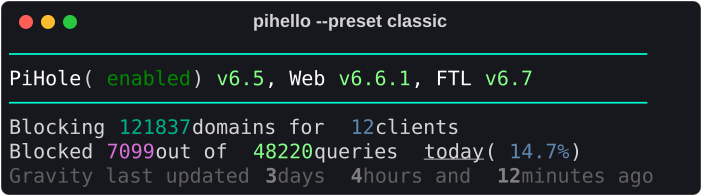
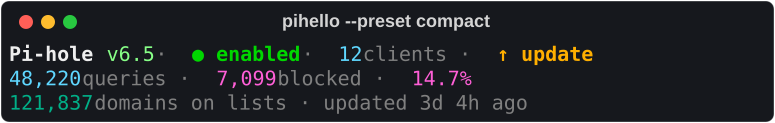
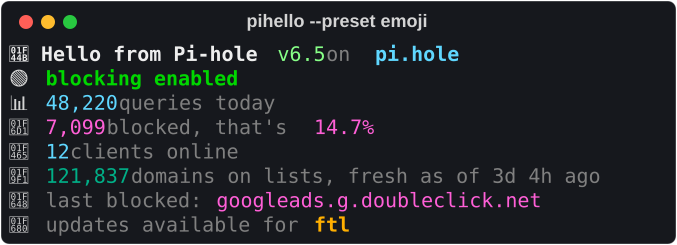
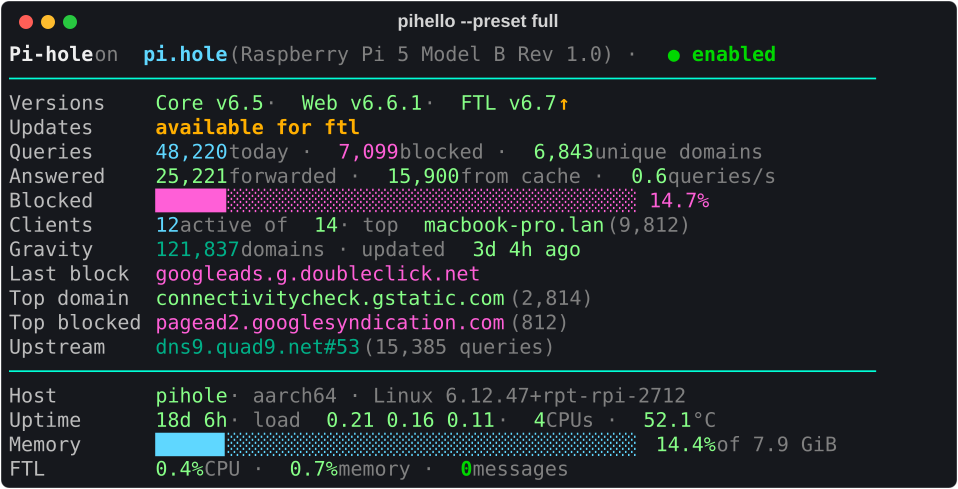
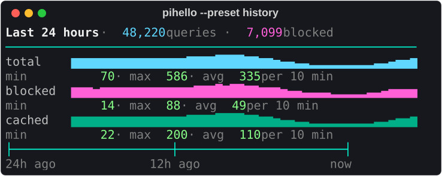
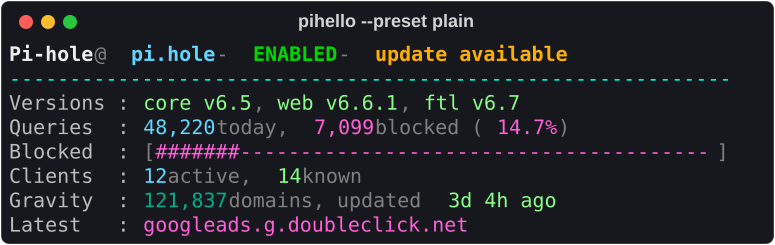
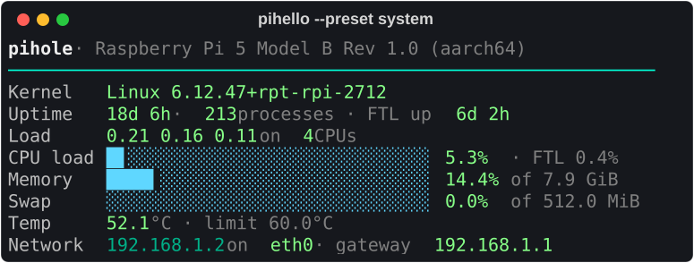
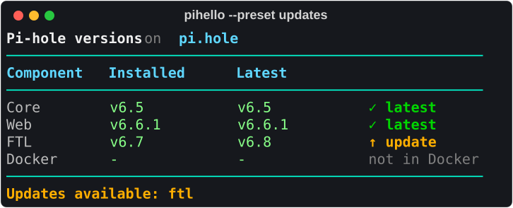

# Presets

<!-- Generated by scripts/render_screenshots.py from demo data; do not edit by hand.
     Run `uv run python scripts/render_screenshots.py` after changing a preset or theme. -->

A preset is a built-in [template](templates.md).
Choose one with `--preset NAME` (or `preset = "NAME"` in the config file)
and combine it with any [theme](themes.md).
`pihello presets` previews them all in your terminal with demo data;
`--live` uses your Pi-hole's data instead.

Every preset except `classic` uses the theme's [style names](themes.md#style-names),
so it works with every theme.
*Min width* is the widest line rendered from demo data;
narrower terminals wrap the lines (or clip them with `overflow = "clip"`).

| Preset | Description | Min width |
| :-- | :-- | --: |
| [`default`](#default) | The flagship greeting: status, versions, queries, clients, gravity | 62 |
| [`box`](#box) | Framed MOTD-style greeting with rounded borders | 56 |
| [`classic`](#classic) | The exact pihello 1.x look, fixed colors | 54 |
| [`compact`](#compact) | Three short lines: status, queries, gravity | 60 |
| [`dashboard`](#dashboard) | PADD-inspired sectioned dashboard with bars and 24h sparklines | 66 |
| [`emoji`](#emoji) | Playful, emoji-decorated summary | 50 |
| [`fetch`](#fetch) | Neofetch-style: Pi-hole logo on the left, key: value info on the right | 66 |
| [`full`](#full) | Everything useful: versions, queries, system, top lists, upstream | 75 |
| [`history`](#history) | 24 hour sparklines of total, blocked and cached queries with min/max/avg | 57 |
| [`minimal`](#minimal) | A single line with status and today's numbers | 63 |
| [`plain`](#plain) | ASCII only, no box drawing or emoji; safe for logs and old terminals | 60 |
| [`status`](#status) | Ultra-short segment for tmux, starship and status bars | 25 |
| [`system`](#system) | Host focus: uptime, load, CPU, memory and swap bars, temperature, network | 60 |
| [`top`](#top) | Top 5 permitted domains, blocked domains and clients | 64 |
| [`updates`](#updates) | Component versions table with update markers | 56 |

To make your own, save a copy of a preset and edit it;
[Templates](templates.md) describes the language:

```sh
pihello presets default --source -o ~/.config/pihello/greeting.txt
```

## `default`

The flagship greeting: status, versions, queries, clients, gravity.



```sh
pihello --preset default                                            # use it
pihello presets default --source -o ~/.config/pihello/default.txt   # copy it to edit
```

**Min width:** 62 columns

<details>
<summary>Template source</summary>

```text
{# default: pihello's flagship greeting, fits 60 columns.                  #}
{# Status (with disable timer and update hint), versions with ↑ markers,  #}
{# today's queries with a blocked-percentage bar, clients, gravity and    #}
{# the most recently blocked domain. Works with every theme.              #}
[@title]Pi-hole[@muted] on [@subtitle]{pihole.host}[@muted] · [{blocking|map(enabled=@good, disabled=@bad, _=@warn)}]● {blocking}[@warn]{timer|duration|prefix(" for ")|default("")}[@muted]{updates.available|if("  ")}[@warn]{updates.available|if("↑ update available")}
[@border]{"─"|repeat(60)}
[@label]Versions   [@value]Core {version.core.local.version}[@warn]{version.core.update|if("↑")}[@muted] · [@value]Web {version.web.local.version}[@warn]{version.web.update|if("↑")}[@muted] · [@value]FTL {version.ftl.local.version}[@warn]{version.ftl.update|if("↑")}
[@label]Queries    [@accent]{queries.total|number}[@muted] today · [@highlight]{queries.blocked|number}[@muted] blocked
[@label]Blocked    [@highlight]{queries.percent_blocked|bar(36)} {queries.percent_blocked|percent}
[@label]Clients    [@accent]{clients.active|number}[@muted] active · [@value]{clients.total|number}[@muted] known
[@label]Gravity    [@info]{gravity.domains_being_blocked|number}[@muted] domains · updated [@value]{gravity.last_update|ago}
[@label]Last block [@highlight]{recent_blocked|default("none yet")|truncate(48)}[]
```

</details>

## `box`

Framed MOTD-style greeting with rounded borders.


```sh
pihello --preset box                                        # use it
pihello presets box --source -o ~/.config/pihello/box.txt   # copy it to edit
```

**Min width:** 56 columns

<details>
<summary>Template source</summary>

```text
{# box: a framed MOTD-style greeting with rounded borders (56 columns).   #}
{# Every dynamic value is padded/truncated to a fixed width (ljust/rjust/ #}
{# truncate, default("?") for missing data), so the right border always   #}
{# lines up.                                                               #}
[@border]╭──────────────────────────────────────────────────────╮
[@border]│ [@title]Pi-hole[@muted] · [@subtitle]{pihole.host|truncate(19)|ljust(20)}[@warn]{timer|duration|prefix("for ")|default("")|truncate(11)|rjust(11)} [{blocking|default("unknown")|map(enabled=@good, disabled=@bad, _=@warn)}]{blocking|default("unknown")|map(enabled=" ● enabled", disabled="● disabled", failed="  ● failed", _=" ● unknown")}[@border] │
[@border]│ [@label]Core [@value]{version.core.local.version|default("?")|truncate(8)|ljust(8)} [@label]Web [@value]{version.web.local.version|default("?")|truncate(8)|ljust(8)} [@label]FTL [@value]{version.ftl.local.version|default("?")|truncate(8)|ljust(8)}[@warn]{updates.available|if("↑ updates")|rjust(13)}[@border] │
[@border]├──────────────────────────────────────────────────────┤
[@border]│ [@label]Queries [@accent]{queries.total|number|default("?")|rjust(14)}      [@label]Clients [@accent]{clients.active|number|default("?")|rjust(16)}[@border] │
[@border]│ [@label]Blocked [@highlight]{queries.blocked|number|default("?")|rjust(14)}      [@label]Ratio   [@highlight]{queries.percent_blocked|percent|default("?")|rjust(16)}[@border] │
[@border]│ [@label]Gravity [@info]{gravity.domains_being_blocked|number|default("?")|rjust(14)}      [@label]Updated [@value]{gravity.last_update|ago|default("?")|rjust(16)}[@border] │
[@border]├──────────────────────────────────────────────────────┤
[@border]│ [@label]Last blocked  [@highlight]{recent_blocked|default("none yet")|truncate(38)|ljust(38)}[@border] │
[@border]╰──────────────────────────────────────────────────────╯[]
```

</details>

## `classic`

The exact pihello 1.x look, fixed colors.



```sh
pihello --preset classic                                            # use it
pihello presets classic --source -o ~/.config/pihello/classic.txt   # copy it to edit
```

**Min width:** 54 columns

<details>
<summary>Template source</summary>

```text
{# classic: the exact pihello 1.x default greeting, with its fixed colors. #}
{# It ignores the theme on purpose; copy it to a file to customise it.    #}
[cyan2]─────────────────────────────────────────────────────[]
[white]PiHole[] ([green4]{blocking}[]) [lightgreen]{version.core.local.version}[white], Web [lightgreen]{version.web.local.version}[white], FTL [lightgreen]{version.ftl.local.version}
[cyan2]─────────────────────────────────────────────────────[]
Blocking [darkcyan]{gravity.domains_being_blocked}[] domains for [steelblue]{clients.active}[] clients
Blocked [fuchsia]{queries.blocked}[] out of [lightgreen]{queries.total}[] queries [underline]today[] ([steelblue]{queries.percent_blocked}%[])
[grey37]Gravity last updated [bold grey50]{gravity.relative.days}[grey37] days [bold grey50]{gravity.relative.hours}[grey37] hours and [bold grey50]{gravity.relative.minutes}[grey37] minutes ago
```

</details>

## `compact`

Three short lines: status, queries, gravity.



```sh
pihello --preset compact                                            # use it
pihello presets compact --source -o ~/.config/pihello/compact.txt   # copy it to edit
```

**Min width:** 60 columns

<details>
<summary>Template source</summary>

```text
{# compact: three short lines: status, today's queries, gravity. #}
[@title]Pi-hole [@value]{version.core.local.version}[@muted] · [{blocking|map(enabled=@good, disabled=@bad, _=@warn)}]● {blocking}[@warn]{timer|duration|prefix(" for ")|default("")}[@muted] · [@accent]{clients.active|number}[@muted] clients[@muted]{updates.available|if(" · ")}[@warn]{updates.available|if("↑ update")}
[@accent]{queries.total|number}[@muted] queries · [@highlight]{queries.blocked|number}[@muted] blocked · [@highlight]{queries.percent_blocked|percent}
[@info]{gravity.domains_being_blocked|number}[@muted] domains on lists · updated {gravity.last_update|ago}[]
```

</details>

## `dashboard`

PADD-inspired sectioned dashboard with bars and 24h sparklines.


```sh
pihello --preset dashboard                                              # use it
pihello presets dashboard --source -o ~/.config/pihello/dashboard.txt   # copy it to edit
```

**Min width:** 66 columns

<details>
<summary>Template source</summary>

```text
{# dashboard: a PADD-inspired dashboard (64 columns) with STATS, NETWORK  #}
{# and SYSTEM sections, percentage bars and 24 hour query sparklines.     #}
{# CPU load is the 1-minute load average relative to the number of cores. #}
[@title]Pi-hole[@muted] · [@value]Core {version.core.local.version}[@warn]{version.core.update|if("↑")}[@muted] · [@value]Web {version.web.local.version}[@warn]{version.web.update|if("↑")}[@muted] · [@value]FTL {version.ftl.local.version}[@warn]{version.ftl.update|if("↑")}[@muted] · [{blocking|map(enabled=@good, disabled=@bad, _=@warn)}]● {blocking|upper}[@warn]{timer|duration|prefix(" ")|default("")}
[@border]━━ [@subtitle]STATS [@border]━━━━━━━━━━━━━━━━━━━━━━━━━━━━━━━━━━━━━━━━━━━━━━━━━━━━━━━
[@label]Blocking   [@info]{gravity.domains_being_blocked|number|suffix(" domains")|default("?")|ljust(21)}[@label]Clients    [@accent]{clients.active|number}[@muted] of {clients.total|number}
[@label]Queries    [@accent]{queries.total|number|default("?")|ljust(21)}[@label]Blocked    [@highlight]{queries.blocked|number}
[@label]Piholed    [@highlight]{queries.percent_blocked|bar(44)} {queries.percent_blocked|percent|rjust(6)}
[@label]24h total  [@accent]{history|pluck(total)|spark(44)}[@muted] max {history|pluck(total)|max|compact}
[@label]24h block  [@highlight]{history|pluck(blocked)|spark(44)}[@muted] max {history|pluck(blocked)|max|compact}
[@label]Latest     [@highlight]{recent_blocked|default("none yet")|truncate(52)}
[@label]Top ad     [@highlight]{top_blocked.0.domain|default("n/a")|truncate(40)}[@muted]{top_blocked.0.count|number|prefix(" (")|suffix(")")|default("")}
[@label]Top domain [@value]{top_domains.0.domain|default("n/a")|truncate(40)}[@muted]{top_domains.0.count|number|prefix(" (")|suffix(")")|default("")}
[@label]Top client [@value]{top_clients.0.label|default("n/a")|truncate(40)}[@muted]{top_clients.0.count|number|prefix(" (")|suffix(")")|default("")}
[@border]━━ [@subtitle]NETWORK [@border]━━━━━━━━━━━━━━━━━━━━━━━━━━━━━━━━━━━━━━━━━━━━━━━━━━━━━
[@label]Hostname   [@value]{host.uname.nodename|default("n/a")|truncate(20)|ljust(21)}[@label]Address    [@info]{network.address|default("n/a")}
[@label]Interface  [@value]{network.interface|default("n/a")|truncate(20)|ljust(21)}[@label]Gateway    [@info]{network.gateway|default("n/a")}
[@label]Upstream   [@info]{upstreams.0.label|default("n/a")|truncate(40)}[@muted]{upstreams.0.count|number|prefix(" (")|suffix(")")|default("")}
[@border]━━ [@subtitle]SYSTEM [@border]━━━━━━━━━━━━━━━━━━━━━━━━━━━━━━━━━━━━━━━━━━━━━━━━━━━━━━
[@label]Model      [@value]{host.model|default("n/a")|truncate(52)}
[@label]Uptime     [@value]{system.uptime|duration|default("?")|ljust(21)}[@label]Load       [@value]{system.cpu.load.raw.0:.2f} {system.cpu.load.raw.1:.2f} {system.cpu.load.raw.2:.2f}
[@label]Processes  [@value]{system.procs|number|default("?")|ljust(21)}[@label]CPU temp   [@value]{sensors.cpu_temp|round(1)|default("n/a")}[@muted]°{sensors.unit|default("C")}
[@label]CPU load   [@accent]{system.cpu.load.percent.0|bar(44)} [@value]{system.cpu.load.percent.0|percent|rjust(6)}
[@label]Memory     [@accent]{system.memory.ram.%used|bar(44)} [@value]{system.memory.ram.%used|percent|rjust(6)}[]
```

</details>

## `emoji`

Playful, emoji-decorated summary.



```sh
pihello --preset emoji                                          # use it
pihello presets emoji --source -o ~/.config/pihello/emoji.txt   # copy it to edit
```

**Min width:** 50 columns

<details>
<summary>Template source</summary>

```text
{# emoji: a playful greeting. Only uses emoji that terminals always draw two #}
{# cells wide (no variation selectors), so the layout stays aligned.        #}
[@title]👋 Hello from Pi-hole [@value]{version.core.local.version}[@muted] on [@subtitle]{pihole.host}
[]{blocking|map(enabled="🟢", disabled="🔴", _="🟡")} [{blocking|map(enabled=@good, disabled=@bad, _=@warn)}]blocking {blocking}[@warn]{timer|duration|prefix(" for ")|default("")}
[]📊 [@accent]{queries.total|number}[@muted] queries today
[]🛑 [@highlight]{queries.blocked|number}[@muted] blocked, that's [@highlight]{queries.percent_blocked|percent}
[]👥 [@accent]{clients.active|number}[@muted] clients online
[]🧱 [@info]{gravity.domains_being_blocked|number}[@muted] domains on lists, fresh as of {gravity.last_update|ago}
[]🙈 [@muted]last blocked: [@highlight]{recent_blocked|default("nothing yet")|truncate(36)}
[]{updates.status|default("unknown")|map(available="🚀", current="✨", _="❔")} [@muted]{updates.status|default("unknown")|map(available="updates available for ", current="everything is up to date", _="update status unknown")}[@warn]{updates.components|join(", ")|default("")}[]
```

</details>

## `fetch`

Neofetch-style: Pi-hole logo on the left, key: value info on the right.


```sh
pihello --preset fetch                                          # use it
pihello presets fetch --source -o ~/.config/pihello/fetch.txt   # copy it to edit
```

**Min width:** 66 columns

<details>
<summary>Template source</summary>

```text
{# fetch: neofetch/fastfetch style, the Pi-hole berry from the installer #}
{# on the left (leaf in @good, berry in @highlight), key: value on the   #}
{# right, and a strip of the theme's colors at the bottom.               #}
[@good] .;;,.                        [@title]pi-hole[@muted]@[@title]{pihole.host}
[@good] .ccccc:,.                    [@border]{"─"|repeat(20)}
[@good]  :cccclll:.      ..,,        [@subtitle]Status[@muted]: [{blocking|map(enabled=@good, disabled=@bad, _=@warn)}]● {blocking}[@warn]{timer|duration|prefix(" for ")|default("")}
[@good]   :ccccclll.   ;ooodc        [@subtitle]Core[@muted]: [@value]{version.core.local.version}[@warn]{version.core.update|if("↑")}
[@good]    'ccll:;ll .oooodc         [@subtitle]Web[@muted]: [@value]{version.web.local.version}[@warn]{version.web.update|if("↑")}
[@good]      .;cll.;;looo:.          [@subtitle]FTL[@muted]: [@value]{version.ftl.local.version}[@warn]{version.ftl.update|if("↑")}
[@highlight]          .. ','.             [@subtitle]Queries[@muted]: [@accent]{queries.total|number}[@muted] today
[@highlight]         .',,,,,,'.           [@subtitle]Blocked[@muted]: [@highlight]{queries.blocked|number}[@muted] ([@highlight]{queries.percent_blocked|percent}[@muted])
[@highlight]       .',,,,,,,,,,.          [@subtitle]Clients[@muted]: [@accent]{clients.active|number}[@muted] active
[@highlight]     .',,,,,,,,,,,,....       [@subtitle]Gravity[@muted]: [@info]{gravity.domains_being_blocked|number}[@muted] domains
[@highlight]   ....''',,,,,,,'.......     [@subtitle]Updated[@muted]: [@value]{gravity.last_update|ago}
[@highlight] .........  ....  .........   [@subtitle]Upstream[@muted]: [@info]{upstreams.0.label|default("n/a")|truncate(28)}
[@highlight] ..........      ..........   [@subtitle]Host[@muted]: [@value]{host.model|default("n/a")|truncate(30)}
[@highlight] ..........      ..........   [@subtitle]Kernel[@muted]: [@value]{host.uname.sysname|default("Linux")} {host.uname.release|default("n/a")|truncate(26)}
[@highlight] .........  ....  .........   [@subtitle]Uptime[@muted]: [@value]{system.uptime|duration(long)}
[@highlight]   ........,,,,,,,'......     [@subtitle]Load[@muted]: [@value]{system.cpu.load.raw.0:.2f} {system.cpu.load.raw.1:.2f} {system.cpu.load.raw.2:.2f}
[@highlight]     ....',,,,,,,,,,,,.       [@subtitle]Memory[@muted]: [@value]{system.memory.ram.used|bytes(KiB)}[@muted] / [@value]{system.memory.ram.total|bytes(KiB)}[@muted] ({system.memory.ram.%used|percent})
[@highlight]        .',,,,,,,,,'.         [@subtitle]CPU temp[@muted]: [@value]{sensors.cpu_temp|round(1)|default("n/a")}[@muted]°{sensors.unit|default("C")}
[@highlight]         .',,,,,,'.
[@highlight]           ..'''.             [@title]███[@subtitle]███[@accent]███[@info]███[@good]███[@warn]███[@bad]███[@highlight]███[]
```

</details>

## `full`

Everything useful: versions, queries, system, top lists, upstream.



```sh
pihello --preset full                                         # use it
pihello presets full --source -o ~/.config/pihello/full.txt   # copy it to edit
```

**Min width:** 75 columns

<details>
<summary>Template source</summary>

```text
{# full: everything useful on one screen (72 columns): versions and updates, #}
{# blocking, queries, clients, gravity, top lists, upstream, system health #}
{# and FTL. Optional data degrades to "n/a".                              #}
[@title]Pi-hole[@muted] on [@subtitle]{pihole.host}[@muted]{host.model|default("")|truncate(32)|prefix(" (")|suffix(")")} · [{blocking|map(enabled=@good, disabled=@bad, _=@warn)}]● {blocking}[@warn]{timer|duration|prefix(" for ")|default("")}
[@border]{"─"|repeat(72)}
[@label]Versions    [@value]Core {version.core.local.version}[@warn]{version.core.update|if("↑")}[@muted] · [@value]Web {version.web.local.version}[@warn]{version.web.update|if("↑")}[@muted] · [@value]FTL {version.ftl.local.version}[@warn]{version.ftl.update|if("↑")}[@muted]{version.docker.local|prefix(" · Docker ")|default("")}
[@label]Updates     [{updates.status|default("unknown")|map(available=@warn, current=@good, _=@muted)}]{updates.components|join(", ")|prefix("available for ")|default("")}{updates.status|default("unknown")|map(available="", current="up to date", _="unknown")}
[@label]Queries     [@accent]{queries.total|number}[@muted] today · [@highlight]{queries.blocked|number}[@muted] blocked · [@value]{queries.unique_domains|number}[@muted] unique domains
[@label]Answered    [@value]{queries.forwarded|number}[@muted] forwarded · [@value]{queries.cached|number}[@muted] from cache · [@value]{queries.frequency|round(1)}[@muted] queries/s
[@label]Blocked     [@highlight]{queries.percent_blocked|bar(40)} {queries.percent_blocked|percent}
[@label]Clients     [@accent]{clients.active|number}[@muted] active of [@value]{clients.total|number}[@muted] · top [@value]{top_clients.0.label|default("n/a")|truncate(24)}[@muted]{top_clients.0.count|number|prefix(" (")|suffix(")")|default("")}
[@label]Gravity     [@info]{gravity.domains_being_blocked|number}[@muted] domains · updated [@value]{gravity.last_update|ago}
[@label]Last block  [@highlight]{recent_blocked|default("none yet")|truncate(58)}
[@label]Top domain  [@value]{top_domains.0.domain|default("n/a")|truncate(46)}[@muted]{top_domains.0.count|number|prefix(" (")|suffix(")")|default("")}
[@label]Top blocked [@highlight]{top_blocked.0.domain|default("n/a")|truncate(46)}[@muted]{top_blocked.0.count|number|prefix(" (")|suffix(")")|default("")}
[@label]Upstream    [@info]{upstreams.0.label|default("n/a")|truncate(36)}[@muted]{upstreams.0.count|number|prefix(" (")|suffix(" queries)")|default("")}
[@border]{"─"|repeat(72)}
[@label]Host        [@value]{host.uname.nodename|default("n/a")}[@muted] · {host.uname.machine|default("n/a")} · {host.uname.sysname|default("Linux")} {host.uname.release|default("n/a")|truncate(36)}
[@label]Uptime      [@value]{system.uptime|duration}[@muted] · load [@value]{system.cpu.load.raw.0:.2f} {system.cpu.load.raw.1:.2f} {system.cpu.load.raw.2:.2f}[@muted] · [@value]{system.cpu.nprocs}[@muted] CPUs · [@value]{sensors.cpu_temp|round(1)|default("n/a")}[@muted]°{sensors.unit|default("C")}
[@label]Memory      [@accent]{system.memory.ram.%used|bar(40)} [@value]{system.memory.ram.%used|percent}[@muted] of {system.memory.ram.total|bytes(KiB)}
[@label]FTL         [@value]{ftl.%cpu|percent|default("n/a")}[@muted] CPU · [@value]{ftl.%mem|percent|default("n/a")}[@muted] memory · [{messages.count|default(0)|gt(0)|if(@warn, @good)}]{messages.count|default(0)|number}[@muted] messages[]
```

</details>

## `history`

24 hour sparklines of total, blocked and cached queries with min/max/avg.



```sh
pihello --preset history                                            # use it
pihello presets history --source -o ~/.config/pihello/history.txt   # copy it to edit
```

**Min width:** 57 columns

<details>
<summary>Template source</summary>

```text
{# history: the last 24 hours of queries as sparklines (10-minute buckets  #}
{# resampled to 48 cells, so one cell is 30 minutes). Each line is scaled  #}
{# from zero to its own maximum; the numbers below are per 10 minutes.     #}
[@title]Last 24 hours[@muted] · [@accent]{history|pluck(total)|sum|number}[@muted] queries · [@highlight]{history|pluck(blocked)|sum|number}[@muted] blocked
[@border]{"─"|repeat(57)}
[@label]total    [@accent]{history|pluck(total)|spark(48, min=0)}
[@muted]         min [@value]{history|pluck(total)|min|number}[@muted] · max [@value]{history|pluck(total)|max|number}[@muted] · avg [@value]{history|pluck(total)|avg|round|number}[@muted] per 10 min
[@label]blocked  [@highlight]{history|pluck(blocked)|spark(48, min=0)}
[@muted]         min [@value]{history|pluck(blocked)|min|number}[@muted] · max [@value]{history|pluck(blocked)|max|number}[@muted] · avg [@value]{history|pluck(blocked)|avg|round|number}[@muted] per 10 min
[@label]cached   [@info]{history|pluck(cached)|spark(48, min=0)}
[@muted]         min [@value]{history|pluck(cached)|min|number}[@muted] · max [@value]{history|pluck(cached)|max|number}[@muted] · avg [@value]{history|pluck(cached)|avg|round|number}[@muted] per 10 min
[@border]         ├──────────────────────┼───────────────────────┤
[@muted]         24h ago             12h ago                  now[]
```

</details>

## `minimal`

A single line with status and today's numbers.


```sh
pihello --preset minimal                                            # use it
pihello presets minimal --source -o ~/.config/pihello/minimal.txt   # copy it to edit
```

**Min width:** 63 columns

<details>
<summary>Template source</summary>

```text
{# minimal: one line with the blocking status and today's numbers. #}
[{blocking|map(enabled=@good, disabled=@bad, _=@warn)}]●[@title] Pi-hole[@bad]{blocking|map(enabled="")|prefix(" ")}[@muted] · [@accent]{queries.total|compact}[@muted] queries · [@highlight]{queries.percent_blocked|percent}[@muted] blocked · [@accent]{clients.active|number}[@muted] clients[]
```

</details>

## `plain`

ASCII only, no box drawing or emoji; safe for logs and old terminals.



```sh
pihello --preset plain                                          # use it
pihello presets plain --source -o ~/.config/pihello/plain.txt   # copy it to edit
```

**Min width:** 60 columns

<details>
<summary>Template source</summary>

```text
{# plain: ASCII only (no box drawing, block elements or emoji), so it works #}
{# on any terminal, over serial consoles and in log files.                  #}
[@title]Pi-hole[@muted] @ [@subtitle]{pihole.host}[@muted] - [{blocking|map(enabled=@good, disabled=@bad, _=@warn)}]{blocking|upper}[@warn]{timer|duration|prefix(" for ")|default("")}[@muted]{updates.available|if(" - ")}[@warn]{updates.available|if("update available")}
[@border]{"-"|repeat(60)}
[@label]Versions : [@value]core {version.core.local.version}[@muted], [@value]web {version.web.local.version}[@muted], [@value]ftl {version.ftl.local.version}
[@label]Queries  : [@accent]{queries.total|number}[@muted] today, [@highlight]{queries.blocked|number}[@muted] blocked ([@highlight]{queries.percent_blocked|percent}[@muted])
[@label]Blocked  : [@muted]\[[@highlight]{queries.percent_blocked|bar(46, chars="#-")}[@muted]\]
[@label]Clients  : [@accent]{clients.active|number}[@muted] active, [@value]{clients.total|number}[@muted] known
[@label]Gravity  : [@info]{gravity.domains_being_blocked|number}[@muted] domains, updated [@value]{gravity.last_update|ago}
[@label]Latest   : [@highlight]{recent_blocked|default("none yet")|truncate(48, end="...")}[]
```

</details>

## `status`

Ultra-short segment for tmux, starship and status bars.


```sh
pihello --preset status                                           # use it
pihello presets status --source -o ~/.config/pihello/status.txt   # copy it to edit
```

**Min width:** 25 columns

<details>
<summary>Template source</summary>

```text
{# status: an ultra-short segment for tmux, starship, polybar, waybar …    #}
{# The dot shows the blocking state; then % blocked of today's queries.    #}
{# A running disable timer is appended. Use `--color never` where the bar  #}
{# does its own coloring.                                                   #}
[{blocking|map(enabled=@good, disabled=@bad, _=@warn)}]●[@highlight] {queries.percent_blocked|percent}[@muted] of [@accent]{queries.total|compact}[@warn]{timer|duration|prefix(" · ")|default("")}[]
```

</details>

## `system`

Host focus: uptime, load, CPU, memory and swap bars, temperature, network.



```sh
pihello --preset system                                           # use it
pihello presets system --source -o ~/.config/pihello/system.txt   # copy it to edit
```

**Min width:** 60 columns

<details>
<summary>Template source</summary>

```text
{# system: the host Pi-hole runs on: kernel, uptime, load, CPU, memory and #}
{# swap bars, temperature and network. Missing sensors/gateway show "n/a". #}
{# CPU load is the 1-minute load average relative to the number of cores.  #}
[@title]{host.uname.nodename|default("pi-hole")}[@muted]{host.model|default("")|truncate(36)|prefix(" · ")}{host.uname.machine|prefix(" (")|suffix(")")|default("")}
[@border]{"─"|repeat(60)}
[@label]Kernel   [@value]{host.uname.sysname|default("Linux")} {host.uname.release|default("n/a")|truncate(40)}
[@label]Uptime   [@value]{system.uptime|duration}[@muted] · [@value]{system.procs|number}[@muted] processes · FTL up [@value]{ftl.uptime|duration|default("n/a")}
[@label]Load     [@value]{system.cpu.load.raw.0:.2f} {system.cpu.load.raw.1:.2f} {system.cpu.load.raw.2:.2f}[@muted] on [@value]{system.cpu.nprocs}[@muted] CPUs
[@label]CPU load [@accent]{system.cpu.load.percent.0|bar(30)} [@value]{system.cpu.load.percent.0|percent|rjust(6)}[@muted] · FTL {ftl.%cpu|percent|default("n/a")}
[@label]Memory   [@accent]{system.memory.ram.%used|bar(30)} [@value]{system.memory.ram.%used|percent|rjust(6)}[@muted] of {system.memory.ram.total|bytes(KiB)}
[@label]Swap     [@accent]{system.memory.swap.%used|default(0)|bar(30)} [@value]{system.memory.swap.%used|default(0)|percent|rjust(6)}[@muted] of {system.memory.swap.total|default(0)|bytes(KiB)}
[@label]Temp     [@value]{sensors.cpu_temp|round(1)|default("n/a")}[@muted]°{sensors.unit|default("C")} · limit {sensors.hot_limit|default("n/a")}°{sensors.unit|default("C")}
[@label]Network  [@info]{network.address|default("n/a")}[@muted] on [@value]{network.interface|default("n/a")}[@muted] · gateway [@value]{network.gateway|default("n/a")}[]
```

</details>

## `top`

Top 5 permitted domains, blocked domains and clients.


```sh
pihello --preset top                                        # use it
pihello presets top --source -o ~/.config/pihello/top.txt   # copy it to edit
```

**Min width:** 64 columns

<details>
<summary>Template source</summary>

```text
{# top: today's top 5 permitted and blocked domains, and the top 5 clients #}
{# by all queries and by blocked queries. Short lists leave blank rows.    #}
[@subtitle]Top permitted domains            Top blocked domains
[@muted] 1 [@value]{top_domains.0.domain|default("")|truncate(20)|ljust(20)} [@accent]{top_domains.0.count|number|default("")|rjust(7)}  [@muted] 1 [@highlight]{top_blocked.0.domain|default("")|truncate(20)|ljust(20)} [@accent]{top_blocked.0.count|number|default("")|rjust(7)}
[@muted] 2 [@value]{top_domains.1.domain|default("")|truncate(20)|ljust(20)} [@accent]{top_domains.1.count|number|default("")|rjust(7)}  [@muted] 2 [@highlight]{top_blocked.1.domain|default("")|truncate(20)|ljust(20)} [@accent]{top_blocked.1.count|number|default("")|rjust(7)}
[@muted] 3 [@value]{top_domains.2.domain|default("")|truncate(20)|ljust(20)} [@accent]{top_domains.2.count|number|default("")|rjust(7)}  [@muted] 3 [@highlight]{top_blocked.2.domain|default("")|truncate(20)|ljust(20)} [@accent]{top_blocked.2.count|number|default("")|rjust(7)}
[@muted] 4 [@value]{top_domains.3.domain|default("")|truncate(20)|ljust(20)} [@accent]{top_domains.3.count|number|default("")|rjust(7)}  [@muted] 4 [@highlight]{top_blocked.3.domain|default("")|truncate(20)|ljust(20)} [@accent]{top_blocked.3.count|number|default("")|rjust(7)}
[@muted] 5 [@value]{top_domains.4.domain|default("")|truncate(20)|ljust(20)} [@accent]{top_domains.4.count|number|default("")|rjust(7)}  [@muted] 5 [@highlight]{top_blocked.4.domain|default("")|truncate(20)|ljust(20)} [@accent]{top_blocked.4.count|number|default("")|rjust(7)}

[@subtitle]Top clients                      Top blocked clients
[@muted] 1 [@value]{top_clients.0.label|default("")|truncate(20)|ljust(20)} [@accent]{top_clients.0.count|number|default("")|rjust(7)}  [@muted] 1 [@value]{top_blocked_clients.0.label|default("")|truncate(20)|ljust(20)} [@accent]{top_blocked_clients.0.count|number|default("")|rjust(7)}
[@muted] 2 [@value]{top_clients.1.label|default("")|truncate(20)|ljust(20)} [@accent]{top_clients.1.count|number|default("")|rjust(7)}  [@muted] 2 [@value]{top_blocked_clients.1.label|default("")|truncate(20)|ljust(20)} [@accent]{top_blocked_clients.1.count|number|default("")|rjust(7)}
[@muted] 3 [@value]{top_clients.2.label|default("")|truncate(20)|ljust(20)} [@accent]{top_clients.2.count|number|default("")|rjust(7)}  [@muted] 3 [@value]{top_blocked_clients.2.label|default("")|truncate(20)|ljust(20)} [@accent]{top_blocked_clients.2.count|number|default("")|rjust(7)}
[@muted] 4 [@value]{top_clients.3.label|default("")|truncate(20)|ljust(20)} [@accent]{top_clients.3.count|number|default("")|rjust(7)}  [@muted] 4 [@value]{top_blocked_clients.3.label|default("")|truncate(20)|ljust(20)} [@accent]{top_blocked_clients.3.count|number|default("")|rjust(7)}
[@muted] 5 [@value]{top_clients.4.label|default("")|truncate(20)|ljust(20)} [@accent]{top_clients.4.count|number|default("")|rjust(7)}  [@muted] 5 [@value]{top_blocked_clients.4.label|default("")|truncate(20)|ljust(20)} [@accent]{top_blocked_clients.4.count|number|default("")|rjust(7)}[]
```

</details>

## `updates`

Component versions table with update markers.



```sh
pihello --preset updates                                            # use it
pihello presets updates --source -o ~/.config/pihello/updates.txt   # copy it to edit
```

**Min width:** 56 columns

<details>
<summary>Template source</summary>

```text
{# updates: installed vs. latest version of every component, with markers. #}
{# The Docker row only has versions inside the official container image. #}
{# A marker shows "unknown" when Pi-hole has not checked for updates yet.  #}
[@title]Pi-hole versions[@muted] on [@subtitle]{pihole.host}
[@border]{"─"|repeat(56)}
[@subtitle]Component   Installed      Latest
[@border]{"─"|repeat(56)}
[@label]Core        [@value]{version.core.local.version|default("-")|truncate(14)|ljust(14)} [@value]{version.core.remote.version|default("-")|truncate(14)|ljust(14)} [{version.core.update|map(true=@warn, false=@good)|default(@muted)}]{version.core.update|map(true="↑ update", false="✓ latest")|default("unknown")}[@muted]{version.core.local.branch|map(master="")|prefix(" (")|suffix(")")|default("")}
[@label]Web         [@value]{version.web.local.version|default("-")|truncate(14)|ljust(14)} [@value]{version.web.remote.version|default("-")|truncate(14)|ljust(14)} [{version.web.update|map(true=@warn, false=@good)|default(@muted)}]{version.web.update|map(true="↑ update", false="✓ latest")|default("unknown")}[@muted]{version.web.local.branch|map(master="")|prefix(" (")|suffix(")")|default("")}
[@label]FTL         [@value]{version.ftl.local.version|default("-")|truncate(14)|ljust(14)} [@value]{version.ftl.remote.version|default("-")|truncate(14)|ljust(14)} [{version.ftl.update|map(true=@warn, false=@good)|default(@muted)}]{version.ftl.update|map(true="↑ update", false="✓ latest")|default("unknown")}[@muted]{version.ftl.local.branch|map(master="")|prefix(" (")|suffix(")")|default("")}
[@label]Docker      [@value]{version.docker.local|default("-")|truncate(14)|ljust(14)} [@value]{version.docker.remote|default("-")|truncate(14)|ljust(14)} [@warn]{version.docker.update|if("↑ update")}[@muted]{version.docker.local|not|if("not in Docker")}
[@border]{"─"|repeat(56)}
[{updates.status|default("unknown")|map(available=@warn, current=@good, _=@muted)}]{updates.components|join(", ")|prefix("Updates available: ")|default("")}{updates.status|default("unknown")|map(available="", current="Everything is up to date.", _="Update status unknown.")}[]
```

</details>
