# Themes

<!-- Generated by scripts/render_screenshots.py from demo data; do not edit by hand.
     Run `uv run python scripts/render_screenshots.py` after changing a preset or theme. -->

A theme gives each [style name](#style-names) that the presets use a concrete style.
Choose one with `--theme NAME` (or `theme = "NAME"` in the config file).
`pihello themes` previews them all in your own terminal
(try `pihello themes nord --preset dashboard`).
Colors are automatically downgraded to 256 or 16 colors when the terminal needs it.

| Theme | Description |
| :-- | :-- |
| [`default`](#default) | The pihello palette, in the spirit of 1.x: cyan rules, light-green values |
| [`catppuccin`](#catppuccin) | Catppuccin Mocha: soothing pastels on a deep base |
| [`classic16`](#classic16) | Only the 16 basic ANSI colors, so it follows your terminal palette everywhere |
| [`dracula`](#dracula) | Dracula: purple, pink and cyan on a dark background |
| [`gruvbox`](#gruvbox) | Gruvbox dark: retro groove, warm yellows, oranges and aquas |
| [`mono`](#mono) | No colors at all, only bold, dim, italic and underline |
| [`monokai`](#monokai) | Monokai: the classic vivid editor palette |
| [`nord`](#nord) | Nord: arctic, north-bluish frost and aurora colors |
| [`pihole`](#pihole) | Pi-hole brand: logo reds and leaf green with the web dashboard's box colors |
| [`solarized`](#solarized) | Solarized dark: Ethan Schoonover's precise low-contrast palette |
| [`tokyonight`](#tokyonight) | Tokyo Night: neon blues and purples of a city at night |

## Style names

Presets use these twelve styles instead of fixed colors, and so can your own templates:
`[@label]Queries [@value]{queries.total|number}`.

| Style | Description |
| :-- | :-- |
| `title` | The main heading ("Pi-hole") |
| `subtitle` | Secondary headings: section names, the host name |
| `border` | Rules, box frames and separators |
| `label` | Field labels ("Queries", "Gravity") |
| `value` | Ordinary values |
| `muted` | De-emphasised text: units, "ago", hints |
| `accent` | Key numbers: total queries, active clients |
| `good` | Healthy state: blocking enabled, up to date |
| `warn` | Attention: updates available, disable timers |
| `bad` | Failure: blocking disabled, errors |
| `info` | Informational numbers: gravity size, upstreams |
| `highlight` | Blocked things: blocked count, percentage, domains |

To change single styles of a theme,
use the [`[styles]` table](configuration.md#styles) of the config file.
Values are style-tag words (`pihello colors` lists the color names),
and they may refer to the theme's own styles with `@name`:

```toml
# ~/.config/pihello/config.toml
theme = "nord"

[styles]
accent = "bold #ff8800"
highlight = "@bad underline"
```

## `default`

The pihello palette, in the spirit of 1.x: cyan rules, light-green values.

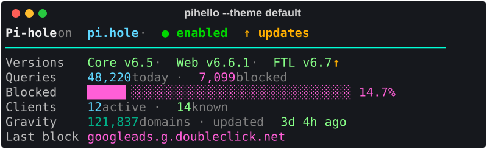

```sh
pihello --theme default
```

<details>
<summary>Styles</summary>

| Style | Words |
| :-- | :-- |
| `title` | `bold grey93` |
| `subtitle` | `bold steelblue1` |
| `border` | `cyan2` |
| `label` | `grey74` |
| `value` | `lightgreen` |
| `muted` | `grey50` |
| `accent` | `steelblue1` |
| `good` | `bold green3` |
| `warn` | `bold orange1` |
| `bad` | `bold red1` |
| `info` | `darkcyan` |
| `highlight` | `hotpink` |

</details>

## `catppuccin`

Catppuccin Mocha: soothing pastels on a deep base.

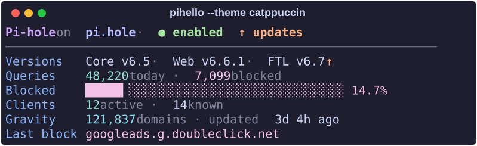

```sh
pihello --theme catppuccin
```

<details>
<summary>Styles</summary>

| Style | Words |
| :-- | :-- |
| `title` | `bold #CBA6F7` |
| `subtitle` | `bold #B4BEFE` |
| `border` | `#6C7086` |
| `label` | `#89B4FA` |
| `value` | `#CDD6F4` |
| `muted` | `#7F849C` |
| `accent` | `#94E2D5` |
| `good` | `bold #A6E3A1` |
| `warn` | `bold #FAB387` |
| `bad` | `bold #F38BA8` |
| `info` | `#89DCEB` |
| `highlight` | `#F5C2E7` |

</details>

## `classic16`

Only the 16 basic ANSI colors, so it follows your terminal palette everywhere.

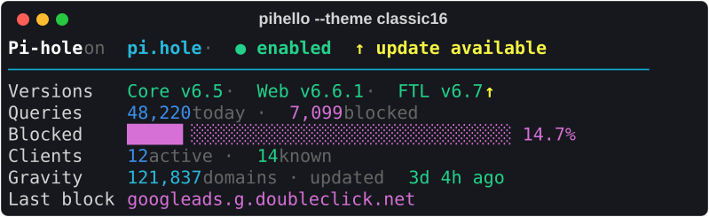

```sh
pihello --theme classic16
```

<details>
<summary>Styles</summary>

| Style | Words |
| :-- | :-- |
| `title` | `bold color(15)` |
| `subtitle` | `bold color(14)` |
| `border` | `color(6)` |
| `label` | `default` |
| `value` | `color(10)` |
| `muted` | `color(8)` |
| `accent` | `color(12)` |
| `good` | `bold color(10)` |
| `warn` | `bold color(11)` |
| `bad` | `bold color(9)` |
| `info` | `color(14)` |
| `highlight` | `color(13)` |

</details>

## `dracula`

Dracula: purple, pink and cyan on a dark background.

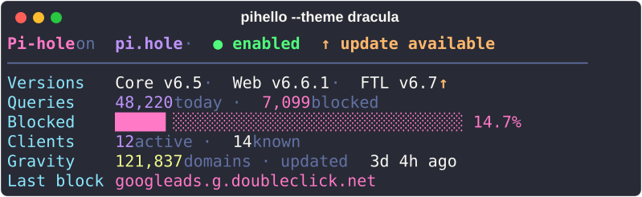

```sh
pihello --theme dracula
```

<details>
<summary>Styles</summary>

| Style | Words |
| :-- | :-- |
| `title` | `bold #FF79C6` |
| `subtitle` | `bold #BD93F9` |
| `border` | `#6272A4` |
| `label` | `#8BE9FD` |
| `value` | `#F8F8F2` |
| `muted` | `#6272A4` |
| `accent` | `#BD93F9` |
| `good` | `bold #50FA7B` |
| `warn` | `bold #FFB86C` |
| `bad` | `bold #FF5555` |
| `info` | `#F1FA8C` |
| `highlight` | `#FF79C6` |

</details>

## `gruvbox`

Gruvbox dark: retro groove, warm yellows, oranges and aquas.

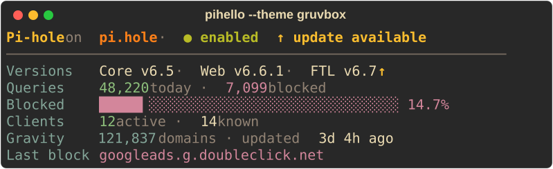

```sh
pihello --theme gruvbox
```

<details>
<summary>Styles</summary>

| Style | Words |
| :-- | :-- |
| `title` | `bold #FABD2F` |
| `subtitle` | `bold #FE8019` |
| `border` | `#7C6F64` |
| `label` | `#83A598` |
| `value` | `#EBDBB2` |
| `muted` | `#928374` |
| `accent` | `#8EC07C` |
| `good` | `bold #B8BB26` |
| `warn` | `bold #FABD2F` |
| `bad` | `bold #FB4934` |
| `info` | `#83A598` |
| `highlight` | `#D3869B` |

</details>

## `mono`

No colors at all, only bold, dim, italic and underline.

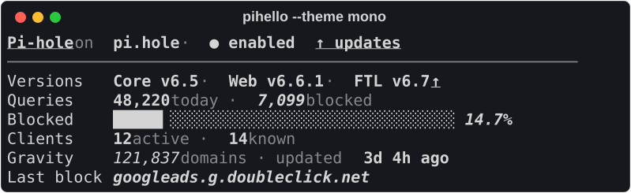

```sh
pihello --theme mono
```

<details>
<summary>Styles</summary>

| Style | Words |
| :-- | :-- |
| `title` | `bold underline` |
| `subtitle` | `bold` |
| `border` | `dim` |
| `label` | `normal` |
| `value` | `bold` |
| `muted` | `dim` |
| `accent` | `bold` |
| `good` | `bold` |
| `warn` | `bold underline` |
| `bad` | `bold reverse` |
| `info` | `italic` |
| `highlight` | `bold italic` |

</details>

## `monokai`

Monokai: the classic vivid editor palette.

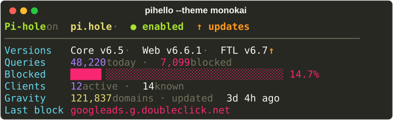

```sh
pihello --theme monokai
```

<details>
<summary>Styles</summary>

| Style | Words |
| :-- | :-- |
| `title` | `bold #A6E22E` |
| `subtitle` | `bold #E6DB74` |
| `border` | `#75715E` |
| `label` | `#66D9EF` |
| `value` | `#F8F8F2` |
| `muted` | `#75715E` |
| `accent` | `#AE81FF` |
| `good` | `bold #A6E22E` |
| `warn` | `bold #FD971F` |
| `bad` | `bold #F92672` |
| `info` | `#E6DB74` |
| `highlight` | `#F92672` |

</details>

## `nord`

Nord: arctic, north-bluish frost and aurora colors.

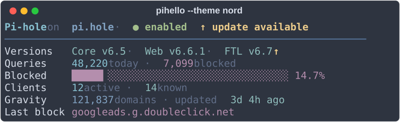

```sh
pihello --theme nord
```

<details>
<summary>Styles</summary>

| Style | Words |
| :-- | :-- |
| `title` | `bold #88C0D0` |
| `subtitle` | `bold #81A1C1` |
| `border` | `#5E81AC` |
| `label` | `#D8DEE9` |
| `value` | `#8FBCBB` |
| `muted` | `#616E88` |
| `accent` | `#88C0D0` |
| `good` | `bold #A3BE8C` |
| `warn` | `bold #EBCB8B` |
| `bad` | `bold #BF616A` |
| `info` | `#81A1C1` |
| `highlight` | `#B48EAD` |

</details>

## `pihole`

Pi-hole brand: logo reds and leaf green with the web dashboard's box colors.

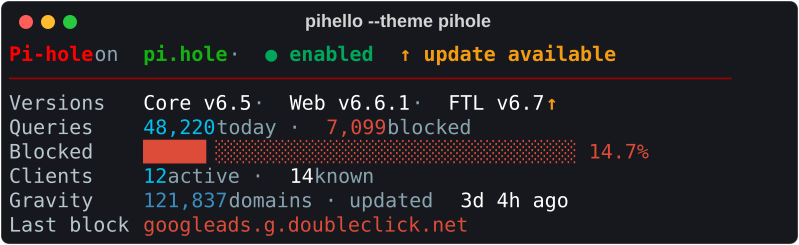

```sh
pihello --theme pihole
```

<details>
<summary>Styles</summary>

| Style | Words |
| :-- | :-- |
| `title` | `bold #FF0000` |
| `subtitle` | `bold #12B212` |
| `border` | `#980200` |
| `label` | `#B8C7CE` |
| `value` | `#FFFFFF` |
| `muted` | `#8AA4AF` |
| `accent` | `#00C0EF` |
| `good` | `bold #00A65A` |
| `warn` | `bold #F39C12` |
| `bad` | `bold #DD4B39` |
| `info` | `#3C8DBC` |
| `highlight` | `#DD4B39` |

</details>

## `solarized`

Solarized dark: Ethan Schoonover's precise low-contrast palette.

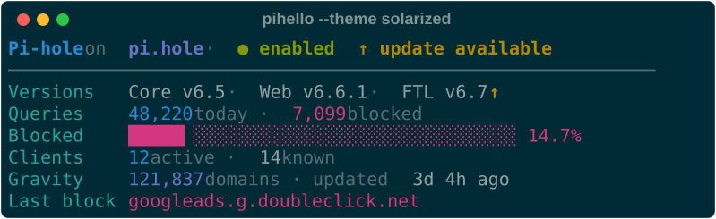

```sh
pihello --theme solarized
```

<details>
<summary>Styles</summary>

| Style | Words |
| :-- | :-- |
| `title` | `bold #268BD2` |
| `subtitle` | `bold #6C71C4` |
| `border` | `#586E75` |
| `label` | `#2AA198` |
| `value` | `#93A1A1` |
| `muted` | `#586E75` |
| `accent` | `#268BD2` |
| `good` | `bold #859900` |
| `warn` | `bold #B58900` |
| `bad` | `bold #DC322F` |
| `info` | `#6C71C4` |
| `highlight` | `#D33682` |

</details>

## `tokyonight`

Tokyo Night: neon blues and purples of a city at night.

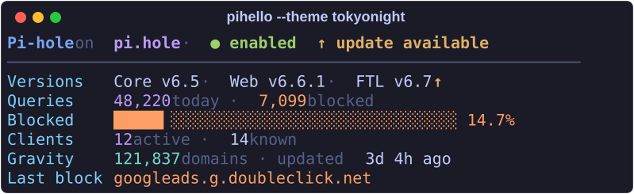

```sh
pihello --theme tokyonight
```

<details>
<summary>Styles</summary>

| Style | Words |
| :-- | :-- |
| `title` | `bold #7AA2F7` |
| `subtitle` | `bold #BB9AF7` |
| `border` | `#545C7E` |
| `label` | `#7DCFFF` |
| `value` | `#C0CAF5` |
| `muted` | `#565F89` |
| `accent` | `#BB9AF7` |
| `good` | `bold #9ECE6A` |
| `warn` | `bold #E0AF68` |
| `bad` | `bold #F7768E` |
| `info` | `#73DACA` |
| `highlight` | `#FF9E64` |

</details>
